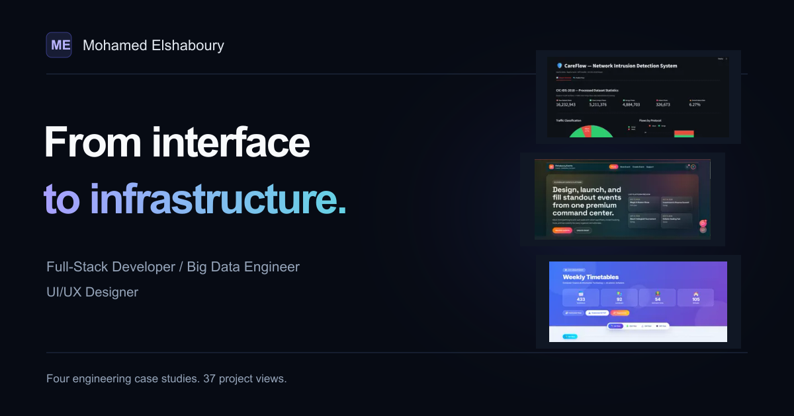

# Mohamed Elshaboury | Portfolio



A responsive portfolio for **Mohamed Abdelaty Mohamed Elshaboury — Full-Stack Developer, Big Data Engineer and UI/UX Designer**, built with React, TypeScript and Vite.

A personal, work-led design with navy surfaces, violet/cyan accents, a compact navigation and an interactive project preview. The four projects appear before the biography, with wider cards and complete media galleries. This version follows the owner's latest request for a distinct identity beyond the earlier authorized reference recreation.

[GitHub](https://github.com/Mohamed-Abdelaty) · [LinkedIn](https://www.linkedin.com/in/mohamed-elshaboury-87a093303/) · [Email](mailto:mohamed.320230191@ejust.edu.eg)

## Features

- Responsive desktop navigation and mobile menu, active sections, dark/light themes and keyboard controls.
- Animated professional roles, progressive reveals and reduced-motion support.
- Work-led hero with four selectable project previews and direct access to each case study.
- Four real projects with a total of 37 reviewed images: CareFlow 10, Events 10, Timetable 10 and CarAgencies 7. Galleries include thumbnails, previous/next controls, keyboard navigation, swipe and a separate full-size viewer.
- Wide case-study panels with one explicit scroll viewport, a persistent chapter navigator, metric/focus summaries, architecture explanations and source links. Mouse-wheel scrolling works over images, thumbnails, headers and text.
- About, education, six expandable skill groups, experience, seven training credentials, achievements, leadership and languages.
- Functional email, GitHub and LinkedIn links; no backend or runtime environment variables.
- Self-hosted fonts with bundled licenses and a locally generated social preview.

## Selected projects

| Project | Engineering focus |
| --- | --- |
| CareFlow IDS | Kafka, Spark, HDFS, Airflow and network-flow classification |
| Elshaboury Events | Express, MySQL, event workflows and ML integration |
| CSIT Timetable Engine | Python, Flask and constraint-driven scheduling |
| CarAgencies | ASP.NET Core, Entity Framework Core and SQL Server |

## Run locally

Use Node.js 22.12+ or a compatible current LTS release. In this workspace:

```powershell
cd D:\My-Portfolio\website
npm ci
npm run dev
```

Open **http://127.0.0.1:5173/**, or the exact port Vite prints if 5173 is already occupied. A clone of this repository has `package.json` directly at its root; run the commands there.

GitHub displays this README; the repository page does not run the React application.

## Preview with Docker

With Docker Desktop running, install dependencies once with `npm ci`, then:

```powershell
npm run build
docker compose up -d --build --wait --wait-timeout 60
```

Open **http://localhost:8080/**. The port is **8080**, bound to this computer only. Nginx serves the host-built `dist/` output; Node.js is not required inside the container.

After editing, run both commands again. To inspect or stop the preview:

```powershell
docker compose ps
docker compose down
```

The Docker context includes only the build files, Nginx configuration and `dist/`. Private originals, QA files, dependencies and environment files are excluded.

## Validation

```sh
npm run typecheck
npm run lint
npm run build
npm test
npm run format:check
```

Build before testing: integrity checks inspect `dist/`. The 14 tests cover content, production privacy and DOM interactions. Additional real-Chrome visual and interaction checks are documented in [GALLERY_AND_IDENTITY.md](GALLERY_AND_IDENTITY.md).

For a Vite production preview, use `npm run preview` and open its printed URL.

## Vercel configuration

| Setting | Value |
| --- | --- |
| Framework | Vite |
| Root directory | `./` |
| Install | `npm ci` |
| Build | `npm run build` |
| Output | `dist` |
| Environment variables | None |

This Git repository contains the local `website/` directory at its root. If deploying the entire parent workspace instead, the application root is `website`, and private source material must remain excluded from Git.

Section anchors require no SPA rewrites. When a real deployment hostname exists, add its canonical URL and an absolute Open Graph image URL to `index.html`. This redesign has not been pushed or publicly deployed.

## Structure and content

- `src/App.tsx`: page composition, about, education, experience, recognition and contact.
- `src/components/`: navigation, hero, skills, project and credential cards, galleries, dialogs and background.
- `src/hooks/`: scroll reveals, typewriter and native dialog lifecycle.
- `src/data.ts`: verified projects, metrics and contact links.
- `src/content.ts`: experience, training, skills, recognition and full name.
- `src/projectStories.ts`: source-grounded architecture explanations.
- `src/style.css`: shared design primitives and motion preferences.
- `src/identity.css`: current work-led layout, responsive navigation, gallery, viewer and scroll viewport.
- `src/projectMedia.ts`: reviewed public image metadata, captions and thumbnail paths.
- `public/`: reviewed images, local graphics and font licenses.
- `tests/`: content, output and interaction checks.
- `qa/`: ignored local screenshots, browser tooling and private review outputs.

Update content from the owner's approved source documents. Keep evaluation results tied to their run and scope, including the timetable's intra-cohort limitation. Training scores and seed transactions are not business outcomes.

Original CVs, certificates and project dossiers remain private. No résumé download is enabled until an approved public version exists. Credential cards contain text summaries, not original certificate scans. No live-demo links are invented.

Normal development and builds require no private documents. `scripts/prepare-assets.mjs` is an optional owner-only asset preparation helper requiring the original inputs. `node scripts/create-social-preview.mjs` regenerates the social graphic without private inputs. Run `npm run format` after source edits.

See [HANDOFF.md](HANDOFF.md) for evidence and [GALLERY_AND_IDENTITY.md](GALLERY_AND_IDENTITY.md) for the current design, complete galleries and mouse-wheel regression checks. [REFERENCE_REDESIGN.md](REFERENCE_REDESIGN.md) records the earlier reference-based iteration.


The gallery preparation helper is `node scripts/prepare-project-gallery.mjs`. It requires the separate private project inputs, generates reviewed WebP derivatives and thumbnails, applies the documented privacy masks, and writes `src/projectMedia.ts`. Review changes to original inputs before regenerating; never copy raw source directories into `public/`. Normal builds use the already prepared public assets.
